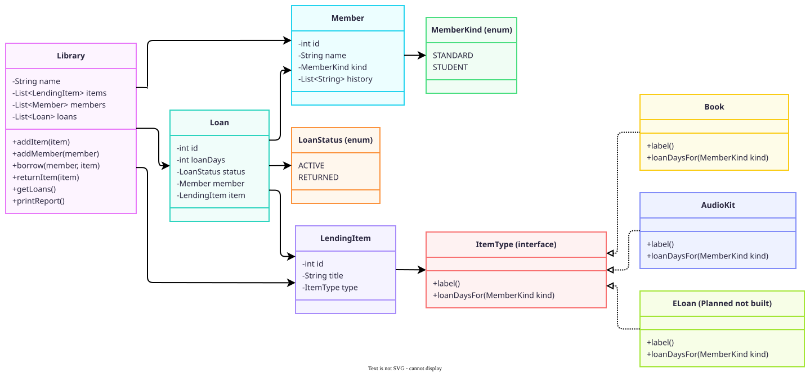

# Diagnosis: The Reading Room Lending Tracker

The tracker runs, but it does not protect its own data. The library's one firm rule is that an item can only be on one loan at a time, and nothing in the code enforces it. These weaknesses also mean a change in one place can break another.

The behaviour below comes from running the starter code: its own `main`, plus a small throwaway test for the other cases. Line numbers refer to `src/main/java/LendingTracker.java`.

## Problems, most dangerous first

### 1. Two separate records of who has an item

`borrow` never checks whether an item is already out (lines 104-125), so a second member can borrow it and nothing complains. The starter's own scenario shows this, and the end-of-day report ends up contradicting itself:

```
"Things Fall Apart" (BOOK): ON_LOAN - with Ama Owusu
Loan #1: "Things Fall Apart" -> Kofi Mensah
Loan #3: "Things Fall Apart" -> Ama Owusu
```

When the book comes back, one return closes both loans and marks the book `AVAILABLE`, so the next report looks normal.

The root cause is that "who has this item?" is stored in two places: `status` and `currentBorrower` on `LendingItem`, and `status` on each `Loan`. Nothing keeps them in step. `borrow` overwrites the first and adds to the second.

For the library, this means the tracker can't be trusted to say who has a book. A volunteer could chase the wrong member, or lose track of the book completely.

This is the most dangerous problem because it breaks the library's one firm rule, and after one return the report no longer shows it happened.

### 2. Any code can change the data directly

The fields are public and `getLoans()` hands out the internal list (lines 36-40, 53-56, 138-140). Setting `item.status = "AVAILABLE"` on a borrowed item makes the report print `AVAILABLE - with Kofi`, and calling `getLoans().clear()` wipes every loan without any error.

The root cause is that these classes only hold data. The rules live somewhere else, so nothing stops other code changing them.

That means fixing `borrow` isn't enough on its own. A later edit could still go around the one-loan rule and it would compile fine. The rule would only hold for as long as every volunteer knew about it and remembered it, and volunteers come and go.

### 3. Item rules are tangled together in one method

`borrow` keeps the book and audio-kit rules in a single `if`/`else if`, and both branches repeat the same status and print lines (lines 106-122). `Library` handles returns and the report as well.

The root cause is that each kind of item has nowhere of its own to keep its rules, so they all end up next to the core lending logic.

To add e-loans, someone would have to add a third branch to this method and copy the same lines again. A mistake there could break books or audio kits too. The brief says an audio-kit change once broke book returns. The code doesn't show how, but all these rules share one class and the same status strings.

### 4. Types and statuses are plain strings

A typo compiles fine and then fails quietly (lines 37-38, 54, 72):

| Mistake | Result |
|---|---|
| Item type `"book"` | `borrow` prints nothing and the item stays `AVAILABLE`, but an active 0-day loan and a history entry still get created |
| Member kind `"student"` | The member gets 14 days on a book instead of a student's 28 |

The root cause is that a `String` can hold any value, and neither `borrow` nor the constructors reject one they don't recognise.

So the records can end up wrong with no warning, and a student could lose their longer loan without anyone noticing. E-loans would add one more string to mistype.

### 5. Loans are linked to items by title

`returnItem` closes every active loan with a matching title (lines 130-134). If Kofi and Ama each have a copy of the same book and Kofi's copy comes back, Ama's loan gets closed too. The report then shows Ama's copy as `ON_LOAN` with no active loan behind it.

The root cause is that `Loan` keeps copies of the title and member name rather than references to the actual item and member.

It's normal for a library to own two copies of a popular book, so this can lose track of a live loan.

### 6. Smaller risks

- **Returns aren't checked:** returning an item that isn't out still prints `Returned`.
- **Membership isn't checked:** an item and member that were never added to the library can still create a loan, and the item won't show in the report's item list.
- **Counters are global:** IDs are static, so they keep counting across `Library` objects (lines 41, 57, 73). There's only one library today, but it makes tests depend on the order they run in.
- **History only goes one way:** `Member.history` records borrows but not returns.

## What the rebuild will and will not change

The brief asks for the same behaviour, except that an item can only be on one loan at a time. The side effects in the table only affect cases the current program never runs, so its output only changes at the refused borrow.

| Case | Rebuild |
|---|---|
| Borrowing an item already on loan | **Changed:** refused with a message, leaving no loan, history entry or used loan ID |
| Valid borrows and returns, loan periods, messages, report format | Unchanged |
| Returning an item that is not out; borrowing with an unregistered item or member; one-sided history | Unchanged, because the brief only changes the one-loan rule. Recorded here as known risks |
| Unknown item types or member kinds (problem 4) | **Side effect of the design:** can no longer be written, so the code will not compile |
| Returning one of two same-titled copies (problem 5) | **Side effect of the design:** closes only that copy's loan |
| Loan numbers across more than one `Library` object | **Side effect of the design:** each library counts its own loans from 1. The program only creates one library, so its output doesn't change |
| Null names, titles, types or kinds | **Side effect of the design:** rejected when the object is created |

## Planned structure (sketch)



**How this answers the problems above:**

- **Problem 1:** an item's status and borrower are worked out from its active loan, so there is no second record to fall out of step. `Loan`'s constructor isn't public, so code outside the `library` package can't create a loan and skip the one-loan check in `Library.borrow`.
- **Problem 2:** fields are private, and lists are returned read-only.
- **Problem 3:** each kind of item owns its own rules. Adding e-loans should mean adding one class, with `Library` and the report left alone.
- **Problems 4 and 5:** types replace strings, and loans point at real objects.

This is a starting plan. Anything that changes during the build will be recorded, with reasons, in the design notes.
